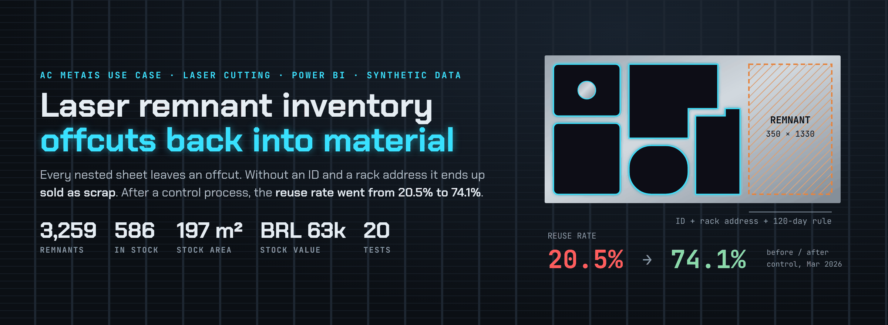
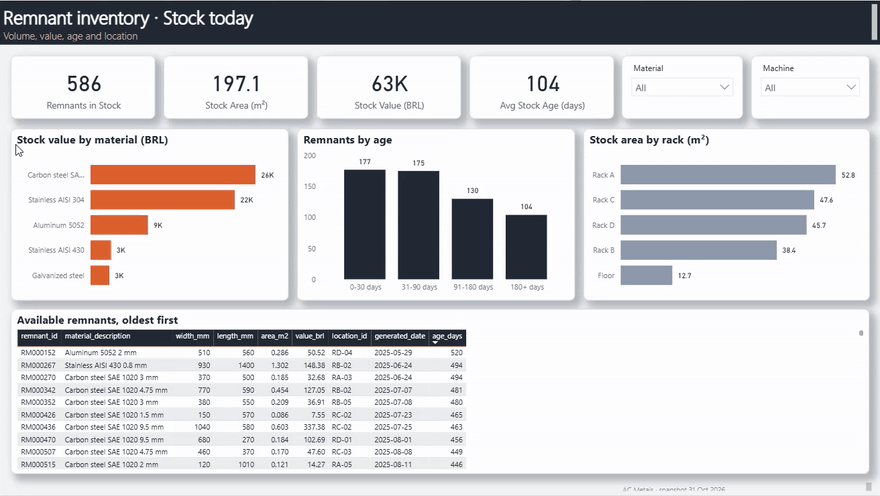
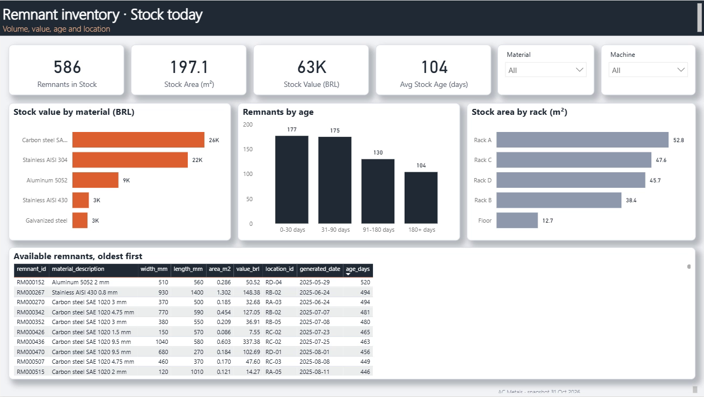
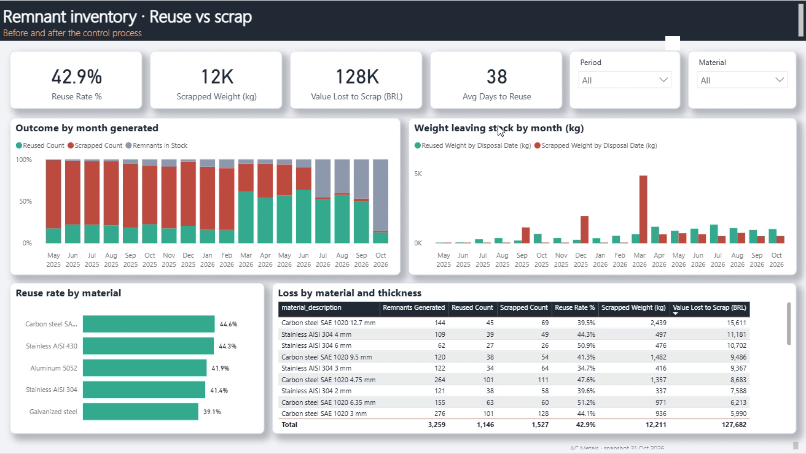
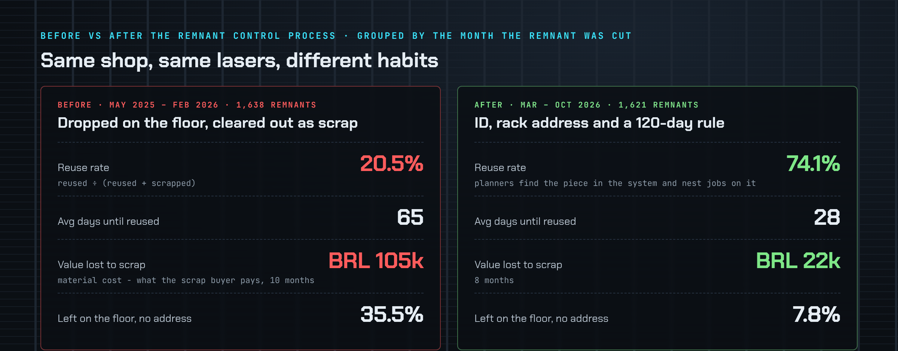
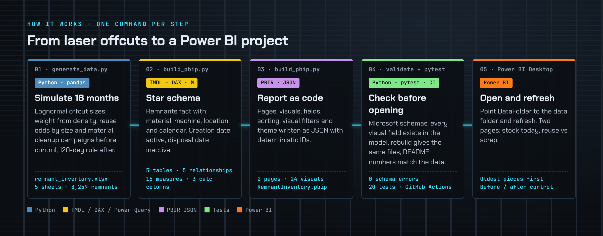
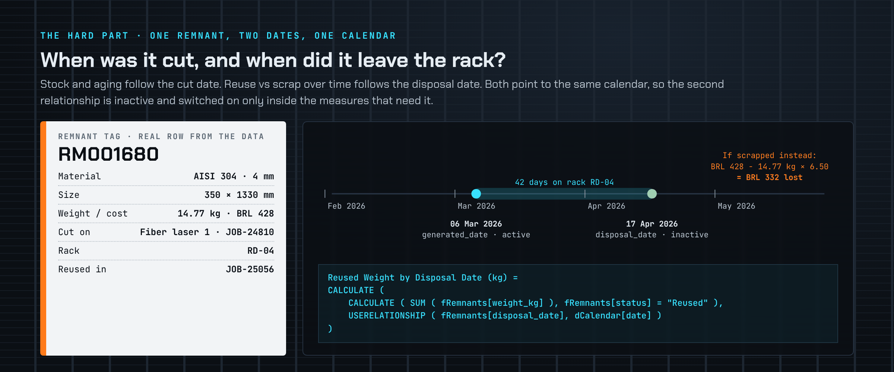

# Laser Remnant Inventory

A Power BI dashboard that tracks sheet metal remnants, the offcuts left on the sheet after laser cutting: what is in stock, how old it is, where it is, and how much is reused instead of sold as scrap.




[](https://github.com/lucasnunesf/laser-remnant-inventory/actions/workflows/tests.yml)

| At a glance | |
|---|---|
| **Result** | After a remnant control process (ID, rack address, 120-day rule), the reuse rate goes from 20.5% to 74.1%, remnants are reused in 28 days instead of 65, and the value lost to scrap drops from BRL 105k in 10 months to BRL 22k in 8. |
| **My role** | I worked with BI at AC Metais, a Brazilian laser cutting and metal fabrication company. This repository rebuilds a remnant control use case from that shop with synthetic data: data generator, data model, DAX, report pages, tests. |
| **What's here** | A Power BI project (`.pbip`) written by Python and published to the Power BI Service: 5 tables, 15 DAX measures, 2 pages, 24 visuals. A data generator, a pandas check of the numbers, 20 automated tests, CI on every commit. |
| **Skills** | Power BI, DAX, Power Query (M), star schema, role-playing dates (`USERELATIONSHIP`), inventory aging, TMDL / PBIR, Python (pandas), pytest, GitHub Actions |
| **Full case** | [docs/case-study.md](docs/case-study.md) |

All data is synthetic. Nothing here comes from the company.

---

## The dashboard

Recorded in the Power BI Service after publishing the project. Slicers and cross-filtering work on both pages.

**Stock today.** What is on the racks, how old it is and where it is. Clicking a material or an age bucket filters the rest of the page, and the table lists the pieces to use next, oldest first.



**Reuse vs scrap.** What happened to the remnants cut each month, and how much material leaves as reuse or as scrap. Clicking a month or a material shows its own reuse rate and loss.


<details>
<summary><b>Full-size screenshots</b></summary>





</details>

The 42.9% reuse rate on the second page covers all 18 months. Split by period, it is 20.5% before the control process and 74.1% after.

---

## Results



Remnants grouped by the month they were cut. Control process live from March 2026.

| | Before control (May 2025 – Feb 2026) | After control (Mar – Oct 2026) |
|---|---:|---:|
| Remnants cut | 1,638 | 1,621 |
| Reuse rate (reused ÷ reused + scrapped) | 20.5% | 74.1% |
| Average days until a remnant is reused | 65 | 28 |
| Value lost to scrap | BRL 105k (10 months) | BRL 22k (8 months) |
| Left on the floor with no address | 35.5% | 7.8% |

Stock on 31 Oct 2026: 586 remnants · 197 m² · BRL 63k · average age 104 days.

---

## The problem

Every sheet nested on a laser leaves a remnant. Without control:

- remnants pile up on the shop floor with no address, so nobody knows what is in stock;
- planners cut new sheets even when a usable remnant exists;
- old pieces are cleared out and sold as scrap, at 10–25% of what the material cost.

The money is invisible: it never shows up as a loss, only as "scrap revenue".

The dashboard answers two questions, one per page:

- **Stock today.** What is on our racks, how old is it, and where is it? KPI cards (remnants, m², BRL, average age), stock value by material, aging buckets, area by rack and the list of available remnants, oldest first, to use next.
- **Reuse vs scrap.** Are we reusing remnants or selling them as scrap, and did the control process help? KPI cards (reuse rate, scrapped kg, value lost, days to reuse), the outcome of each month's remnants, reused vs scrapped kg by the month they left, reuse rate by material, and loss by material and thickness.

---

## How it works



| Step | What it does | Language | Output |
|---|---|---|---|
| `scripts/generate_data.py` | Creates 18 months of remnants: sizes, weight from density, reuse odds by size and material, cleanup campaigns before control and the 120-day rule after. Seeded, so it always gives the same data. | Python | `data/remnant_inventory.xlsx` |
| `scripts/build_pbip.py` | Writes the model in TMDL (tables, Power Query, relationships, calculated columns, measures) and the report in PBIR (one JSON file per page and visual) plus a theme. | Python | `powerbi/RemnantInventory.pbip` |
| `scripts/validate_pbir.py` | Checks every report file against Microsoft's JSON schemas. | Python | `0 schema errors` |
| `scripts/kpi_snapshot.py` | Computes the main numbers with pandas, using the same logic as the DAX, so they can be checked without Power BI. | Python | numbers in the terminal |

### Data model

Star schema, filters in one direction, imported from one Excel file.

```
                 dMaterial            dMachine
                     │ 1                  │ 1
                     │                    │
 dCalendar 1 ──── * fRemnants * ──────────┘
   (date)  ┄┄┄┄┄┄ *  (disposal_date, inactive)
                     │ *
                     │ 1
                 dLocation
```

| Table | Grain | Rows |
|---|---|---|
| `fRemnants` | one remnant | 3,259 |
| `dMaterial` | material + thickness | 26 |
| `dMachine` | laser machine | 3 |
| `dLocation` | rack address or floor area | 24 |
| `dCalendar` | day | 549 |

## Design decisions



- **Two dates, one calendar.** Stock and aging follow the date the remnant was cut. "When did material leave the stock" follows the disposal date. Both point to the same calendar: the cut date is the active relationship and the disposal date is inactive, switched on with `USERELATIONSHIP` only in the measures that need it. The model stays a simple star.
- **Reuse rate only counts pieces that already left the stock.** 586 pieces are still on the racks. Counting them as "not reused" would make the recent months look worse than they are.
- **Value lost, not scrap revenue.** The loss is the material cost minus what the scrap buyer pays:

```DAX
Value Lost to Scrap (BRL) =
SUMX (
    FILTER ( fRemnants, fRemnants[status] = "Scrapped" ),
    fRemnants[value_brl] - fRemnants[weight_kg] * RELATED ( dMaterial[scrap_price_brl_kg] )
)
```

- **Oldest first.** The stock table is sorted by age, so it doubles as the list of pieces to nest next.
- **Report as code.** The `.pbip` format is plain text, so the model and every visual can be reviewed in a pull request and rebuilt with one command. IDs are deterministic, so rebuilding does not create noisy diffs.

---

## Try it

```bash
pip install -r requirements.txt
python scripts/generate_data.py
python scripts/build_pbip.py
python scripts/kpi_snapshot.py
```

Output:

```
3,259 remnants written to .../data/remnant_inventory.xlsx
Built .../powerbi/RemnantInventory.pbip: 5 tables, 15 measures, 2 pages, 24 visuals

Remnants generated         3,259
In stock on 31 Oct 2026    586  ·  197 m²  ·  BRL 63k  ·  avg age 104 days
Stock on the floor         6.3%

                             Before control   After control
Reuse rate                            20.5%           74.1%
Avg days until reused                    65              28
Value lost to scrap (BRL)           105,439          22,243
```

Then, on Windows:

1. Open `powerbi/RemnantInventory.pbip` in Power BI Desktop.
2. *Transform data → Edit parameters →* set **DataFolder** to the full path of the `data` folder, ending with `\`.
3. *Refresh.*

## Tests

```bash
git clone --depth 1 https://github.com/microsoft/json-schemas.git   # optional, for the schema test
pytest
```

```
============================== 20 passed in 4.18s ==============================
```

| File | What it checks |
|---|---|
| `tests/test_data.py` | The generator gives the same file every time. Keys match. Status matches the disposal date and the reuse job. Area, weight and value match size, thickness, density and cost. After control, nothing usable is scrapped before 120 days. Control moves remnants from the floor to the racks. |
| `tests/test_model.py` | Rebuilding gives exactly the files in the repository. Every column and measure used by a visual or a DAX formula exists in the model (the JSON schemas don't check this). A broken visual is caught. All report files pass Microsoft's schemas. |
| `tests/test_kpis.py` | Every number in this README is recomputed from the data. Value lost is cost minus scrap sale. Age of pieces in stock counts to the snapshot date. |

GitHub Actions runs the tests on every commit.

<details>
<summary><b>Project layout</b></summary>

```
data/remnant_inventory.xlsx      synthetic data (5 sheets)
scripts/generate_data.py         data generator (seeded)
scripts/build_pbip.py            builds the model (TMDL) and the report (PBIR)
scripts/validate_pbir.py         schema validation
scripts/kpi_snapshot.py          main numbers with pandas
powerbi/RemnantInventory.pbip    open this in Power BI Desktop
tests/                           data, model and number tests
docs/                            case study and README images
```

</details>

<details>
<summary><b>Glossary</b></summary>

- **Remnant (offcut)**: the part of a sheet left after the laser cuts the parts nested on it. It can still be used for smaller parts.
- **Nesting**: arranging parts on a sheet to use as much of it as possible.
- **Rack address**: the place where a remnant is stored, like RD-04 (rack D, level 4).
- **Reuse rate**: reused ÷ (reused + scrapped), counting only remnants that already left the stock.
- **Value lost to scrap**: material cost of the scrapped piece minus what the scrap buyer pays for it.

</details>

---

## Next steps

- Read remnants from the nesting software export instead of the generator.
- Suggest remnants for new jobs by material, thickness and size.
- Show the 120-day deadline on the stock page, so planners use a piece before it goes to scrap.

## How this was built

The problem, the business rules and the design decisions are mine. They come from my BI work at AC Metais. I used an AI coding assistant to write the code faster and reviewed the result.


## Author

Lucas Fernandes Nunes · [Portfolio](https://lucasnunesf.notion.site) · [GitHub](https://github.com/lucasnunesf)
