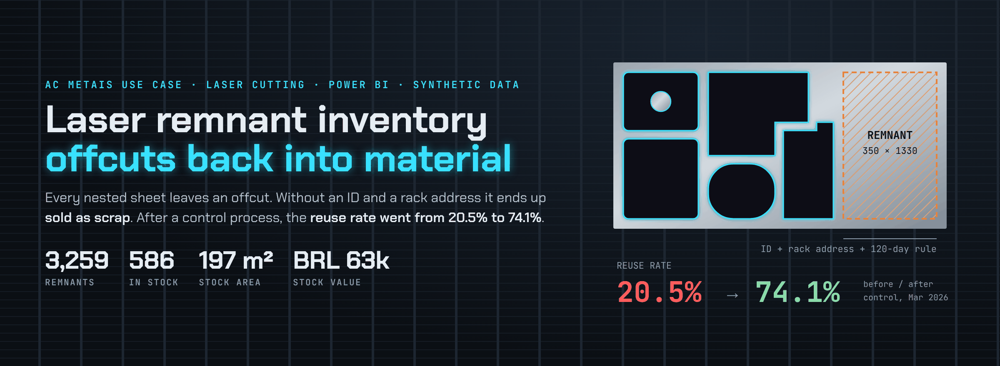
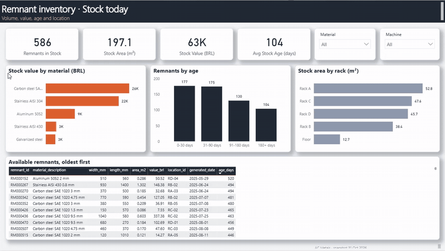
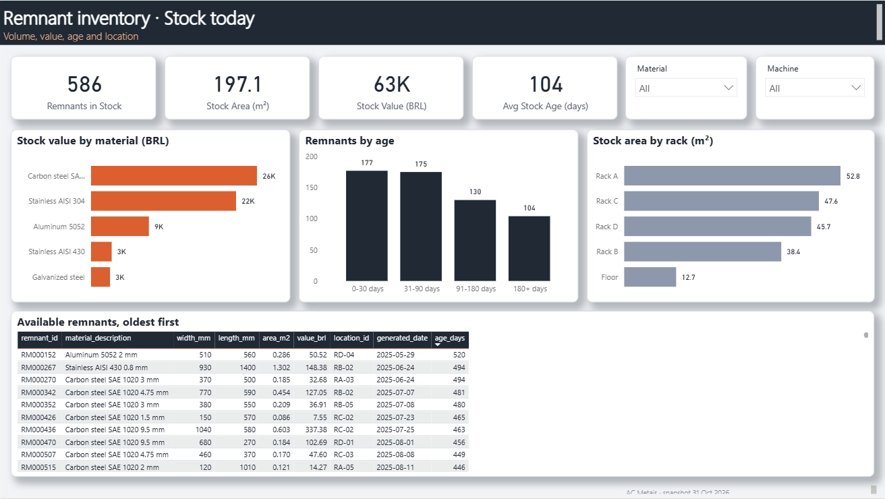
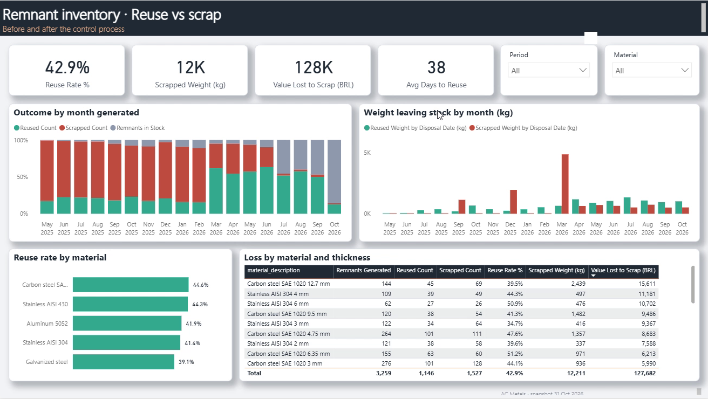
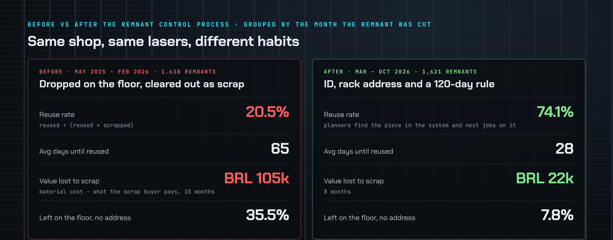

# Laser Remnant Inventory

A Power BI dashboard that tracks sheet metal remnants, the pieces left on the sheet after laser cutting: what is in stock, how old it is, where it is, and how much is reused instead of sold as scrap.

| | |
|---|---|
| **Problem** | Remnants piled up on the floor with no address. Planners cut new sheets even when a usable piece existed, and old pieces were sold as scrap. |
| **Solution** | A control process (ID, rack address, 120-day rule) and a dashboard that shows the stock and how much is reused vs scrapped. |
| **Result** | The reuse rate went from 20.5% to 74.1%, and the value lost to scrap dropped from BRL 105k in 10 months to BRL 22k in 8. |
| **Tools** | Power BI · DAX · Power Query · Excel |
| **Context** | I worked with BI at AC Metais, a Brazilian laser cutting and metal fabrication company. This dashboard rebuilds a remnant control case from that shop with synthetic data. |

---

## The problem

Every sheet cut on a laser leaves a remnant. Without control:

- remnants piled up on the shop floor with no address, so nobody knew what was in stock;
- planners cut new sheets even when a usable remnant existed;
- old pieces were sold as scrap, at 10–25% of what the material cost.

The money lost was invisible: it showed up as "scrap revenue", not as a loss.

## The dashboard

Two pages, published in the Power BI Service. Filters and cross-filtering work on both.

**Stock today.** What is on the racks, how old it is and where it is. Stock value by material, age groups, area by rack and the list of remnants to use next, oldest first.

**Reuse vs scrap.** Are remnants being reused or sold as scrap, and did the control process help? Outcome of each month's remnants, reuse rate by material, and loss by material and thickness.

<b>Full-size screenshots</b>

## Results

Synthetic data. Control process live from March 2026.

| | Before (May 2025 – Feb 2026) | After (Mar – Oct 2026) |
|---|---:|---:|
| Reuse rate | 20.5% | 74.1% |
| Average days until a remnant is reused | 65 | 28 |
| Value lost to scrap | BRL 105k (10 months) | BRL 22k (8 months) |
| Left on the floor with no address | 35.5% | 7.8% |

Stock on 31 Oct 2026: 586 remnants · 197 m² · BRL 63k.

**Decision it supports:** use the oldest remnants first, and keep the ID and rack address rule for every piece.

## Files

| Folder | What is in it |
|---|---|
| `data/` | Synthetic data in Excel |
| `powerbi/` | The Power BI report |
| `docs/` | Images |

To open it, open the report in the `powerbi` folder with Power BI Desktop, point the **DataFolder** parameter (*Transform data → Edit parameters*) to the `data` folder and refresh.

## Background

Based on real experience at AC Metais, a Brazilian laser cutting and metal fabrication company. The problem and the business rules are the real ones; the data is synthetic, so nothing comes from the company.

---

Lucas Fernandes Nunes · [Portfolio](https://lucasnunesf.notion.site/Lucas-Nunes-Data-BI-Analyst-3de917c89c178092885cf639b619767b) · [GitHub](https://github.com/lucasnunesf)
